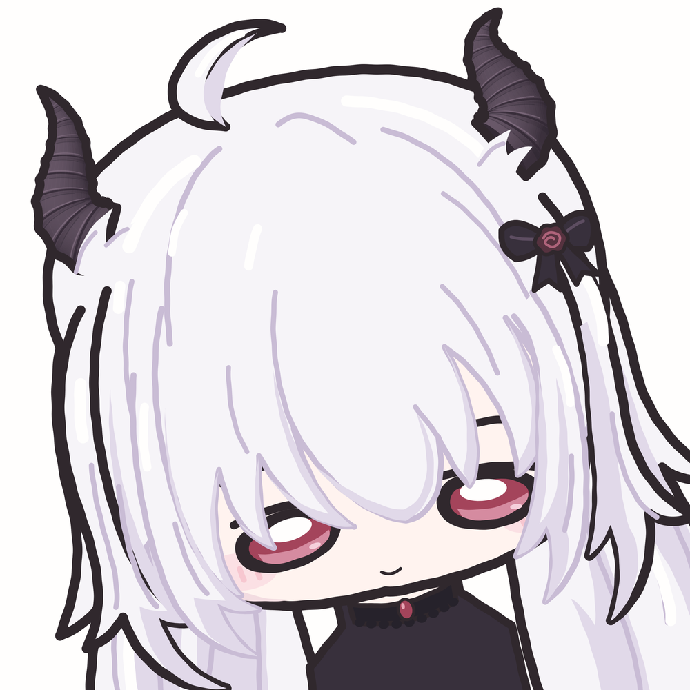

# Yueyue drawing code

A Python-drawn chibi portrait, exported to PNG and SVG. The drawing is split into
independent visual elements so the hair, head, ribbon and clothing can be edited
without changing the two frozen horns. The cross and its hanging chain are removed.



## Render

Tested with Python 3.11 and the versions in `requirements.txt`.

```bash
python -m pip install -r requirements.txt
python draw_yueyue.py
```

The default export is 2400 × 2400 pixels in `output/`. Change the size or directory
with `--size` and `--output`. Render a single element on a transparent background:

```bash
python draw_yueyue.py --element horn-left
python draw_yueyue.py --element head
```

The element choices are `portrait`, `head`, `hair`, `horn-left`, `horn-right`,
`ribbon`, `clothing` and `face`. Every export produces both PNG and SVG. Individual
elements retain their full-canvas positions so their exports align.

## Where to edit

| Element | Script | Scope |
| --- | --- | --- |
| Left horn, as seen by the viewer | `yueyue/elements/horn_left.py` | **Frozen** geometry, size, position and texture seed |
| Right horn, as seen by the viewer | `yueyue/elements/horn_right.py` | **Frozen** geometry, size, position and texture seed |
| Horn surface drawing | `yueyue/elements/_horn_surface.py` | **Frozen** shared shading, growth ridges and grain |
| Head | `yueyue/elements/head.py` | Complete skull outline, neck and head pose |
| Hair | `yueyue/elements/hair.py` | Back lengths, crown, fringe, cheek locks and root tufts |
| Ribbon | `yueyue/elements/ribbon.py` | Bow and rose; further detail is deferred |
| Clothing | `yueyue/elements/clothing.py` | Black fabric, collar and jewel |
| Face | `yueyue/elements/face.py` | Eyes, brows, blush and closed mouth |

`yueyue/composition.py` contains the explicit paint order. `yueyue/canvas.py`
contains only drawing/export helpers; `yueyue/palette.py` holds the editable colors.

## Head and hair

The skull is a complete shape underneath the hair, rather than only the exposed
face. Both use the same 1600 × 1600 local coordinates and the head pose from
`head.py`. The crown sits outside the skull to give the hair volume. The back hair
is painted behind the head; the fringe and side locks cover it, including the ears
and cheek edges. Hair paths are authored against this skull: changing its shape
requires adjusting the covering hair deliberately, not an automatic deformation.

Hair has three paint passes because back lengths, front locks and root tufts
occlude different objects. Clothing has back/front passes around the neck. Each
still has one owning script. Root tufts belong to hair, not to either horn.

## Frozen horns

The user has frozen **each horn independently until explicitly told otherwise**.
Keep their geometry, scale, placement, color, texture, seed, outlines and rendering
unchanged. Their poses and colors are independent of editable head/palette values.
Do not redesign a horn while editing another element. Shared renderer changes must
also preserve the horn pixels.

The original single-file drawing is preserved in
[commit 0f58aaf](https://github.com/solo-race/SVG-yueyue-drawing-code/commit/0f58aafe4ad0c46d2e904921f4115881511bbf0f).
The two regression checks compare independently rendered horns against that
pre-refactor baseline:

```bash
python -m unittest discover -s tests -v
```

Both horn renders matched with **zero changed pixels** during the refactor. Do not
replace their expected hashes merely to make a change pass. Use the pinned drawing
dependencies when checking those exact pixels.
